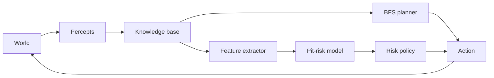
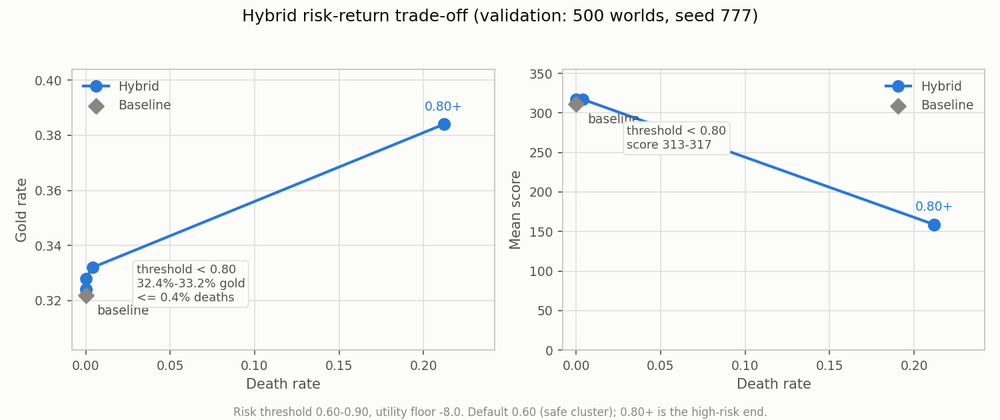

# Hybrid Wumpus Agent

A 4×4 Wumpus World agent that combines a logical knowledge base, BFS planning, and a
scikit-learn pit-risk model. The repository includes a symbolic baseline, a hybrid agent, a
world-level ML pipeline, a paired evaluation harness, and regression tests.

**Result up front:** on 2,000 held-out worlds the hybrid is statistically tied with the
symbolic baseline on the standard score (mean **281.7 vs 282.3**; paired difference **−0.55**,
95% bootstrap CI **[−2.59, 1.48]**). The ML path is not inert, though: relaxing the risk
threshold trades gold for survival. At 0.75 the hybrid gains **+0.60 pp gold** on the held-out
seed at **1.05% deaths**; at 0.80+ on validation, gold rises to 38.4% but deaths jump to 21.2%
and mean score collapses. On validation the hybrid has a small score edge from 0.60 to 0.75, but
that edge does not survive on the held-out seed. This is reported as a negative result on the
headline metric, with the trade-off made explicit rather than tuning the benchmark to manufacture
a win.

## Architecture



- **Knowledge base:** tracks visited cells, `no_pit`, `no_wumpus`, `possible_pit`,
  `possible_wumpus`, and safe cells. No-breeze and no-stench observations propagate safely;
  singleton deductions resolve pits and the Wumpus.
- **Planner:** BFS over `(position, direction)` states, restricted to known-safe cells. Handles
  exploration routes, Wumpus firing positions, gold pickup, and the route home.
- **Hybrid agent:** same safe policy, plus a supervised pit-risk score for frontier cells. A
  frontier is entered only when its combined risk and utility pass both thresholds.
- **Evaluation:** baseline and hybrid run on identical worlds; results are paired by world and
  summarized with bootstrap confidence intervals.

## Results

2,000 random 4×4 worlds, evaluation seed 2025, max 100 actions per episode, logistic-regression
risk model, default risk threshold 0.6 and utility floor −8.0. The baseline and hybrid see the
same world layouts.

| Metric | Baseline | Hybrid | Paired difference (95% CI) |
|---|---:|---:|---:|
| Mean score | 282.27 | 281.72 | −0.55 [−2.59, 1.48] |
| Median score | −1.0 | −1.0 | 0.00 |
| Average steps | 9.06 | 9.10 | +0.04 [−0.01, +0.09] |
| Survival rate | 100% | 100% | 0.00 pp |
| Escape rate | 100% | 100% | 0.00 pp |
| Gold rate | 29.35% | 29.30% | −0.05 pp [−0.25, +0.15] |
| Arrow usage | 21.75% | 21.85% | +0.10 pp [0.00, +0.25] |
| Risky frontier entries | 0.00 | 0.00 | 0.00 |

The confidence interval for the score includes zero, so there is no statistically detectable
improvement. Both agents also survive and escape every world in this sample; the difference is
almost entirely in exploration order and gold collection.

At the default threshold the ML risk path is inactive (`risky_entries = 0`), so the two agents
differ only through safe-target ordering. Across the 2,000 paired worlds:

| Per-world outcome | Worlds | Share |
|---|---:|---:|
| Hybrid score higher | 16 | 0.8% |
| Tied | 1,944 | 97.2% |
| Baseline score higher | 40 | 2.0% |

### What the ML actually does



Validation seed 777, 500 worlds, utility floor −8.0. At the default 0.60 the classifier rejects
every risky frontier, so the hybrid produces no risky entries; the small score differences in the
table come from safe-target ordering. Relaxing the acceptance threshold (moving right in the plot)
turns the ML on: by 0.75 the hybrid gains gold with only 0.4% deaths; at 0.80+ the false positives
become too costly, deaths reach 21.2%, and the standard score collapses. The ML therefore exposes
an explicit risk-return curve rather than a free win. The held-out check below shows the same
pattern: the 0.75 operating point buys **+0.60 pp gold** for a **−4.59 score** difference (CI
includes zero) and 1.05% deaths.

Curated tables are in [`docs/results/`](docs/results/): `eval_summary.csv`,
`paired_comparison.csv`, `threshold_sweep.csv`, `heldout_tradeoff.csv`, `vault_results.csv`,
`exact_inference.csv`, `model_metrics.csv`, and `final_results.txt`.

## Model evaluation

The frontier dataset contains **12,740 rows from 500 worlds**, split by world into 300 training,
100 validation, and 100 test worlds. The test worlds are never used for model selection.

| Model | Validation F1 | Test accuracy | Test precision | Test recall | Test F1 | Test ROC-AUC |
|---|---:|---:|---:|---:|---:|---:|
| Logistic regression | 0.696 | 0.842 | 0.527 | 1.000 | 0.690 | 0.928 |
| Decision tree | **0.700** | 0.853 | 0.547 | 0.963 | 0.698 | 0.932 |
| Random forest | 0.689 | 0.860 | 0.558 | 0.978 | 0.710 | 0.942 |
| Gradient boosting | 0.689 | 0.888 | 0.664 | 0.736 | 0.699 | 0.947 |

The decision tree wins on validation F1, but the hybrid demo and headline evaluation use the
logistic-regression artifact because its smoother probabilities are used as risk scores. All four
models are saved as `artifacts/pit_risk_*.joblib`.

The high recall and low precision are the central ML limitation: the logistic model flags almost
every positive frontier as a pit, plus many safe cells. With a 0.6 acceptance threshold this
blocks nearly all risky exploration, so the hybrid mostly reproduces the baseline's safe policy.
At 0.75 it admits about 0.04 risky entries per world; on the held-out seed that recovers
+0.60 pp gold but adds 1.05% deaths.

## Threshold sweep (validation, then a held-out check)

The risk threshold was swept on a **validation** seed (777, 500 worlds) separate from both training
(seed 42) and the reported evaluation (seed 2025). Utility floor is −8.0.

| Risk threshold | Hybrid score | Baseline score | Hybrid gold | Hybrid deaths | Risky entries |
|---:|---:|---:|---:|---:|---:|
| 0.60 (default) | 313.14 | 311.13 | 32.4% | 0.0% | 0.000 |
| 0.65 | 313.14 | 311.13 | 32.4% | 0.0% | 0.000 |
| 0.70 | **317.17** | 311.13 | 32.8% | 0.0% | 0.004 |
| 0.75 | 317.06 | 311.13 | 33.2% | 0.4% | 0.026 |
| 0.80+ | 158.77 | 311.13 | 38.4% | 21.2% | 0.418 |

The validation-best setting is 0.70, but it did not generalize. The table below reruns 0.70 and
0.75 on the untouched evaluation seed (2,000 worlds, paired by world):

| Setting | Score Δ (95% CI) | Gold Δ (95% CI) | Hybrid deaths |
|---|---:|---:|---:|
| 0.70 | −4.04 [−8.04, −0.10] | 0.00 pp [−0.25, +0.30] | 0.4% |
| 0.75 | −4.59 [−11.54, +1.84] | **+0.60 pp [+0.15, +1.05]** | 1.05% |

At 0.75 the gold improvement is statistically positive, but the score difference is not (its CI
includes zero) and the hybrid loses 1.05% of episodes. The standard score still favors the safe
baseline, which is why the default remains 0.60. The ML is only an advantage if the operator
values gold recovery above survival and mean score.

A designed "gold vault" prototype (a safe gold cell surrounded by breeze cells, unprovable by the
baseline's singleton deductions) still gets an 81–97% pit prediction from all four models, so the
hybrid does not enter it at the default threshold. Running an exact pit-only enumerator over every
assignment consistent with the breeze observations gives **0.77** for the same cell: the classifier
is overconfident, but 0.77 is still far above the safe threshold, and entering would be a 77% death
gamble. Even perfect constraint inference does not justify the move under the standard score. The
bottleneck is irreducible uncertainty, not only the threshold or model capacity.

Reproduce both diagnostics after training:

```bash
uv run python -m app.evaluation.vault
uv run python -m app.evaluation.exact_inference
```

Reproduce the sweep with:

```bash
uv run python -m app.evaluation.sweep --worlds 500 --seed 777
```

## Quickstart

Requires [uv](https://docs.astral.sh/uv/) (Python 3.13 is selected by `.python-version`).

```bash
# From the repository root
uv sync

# Train the four pit-risk models; writes artifacts/ (gitignored)
uv run python -m app.ml.train

# Baseline demo
uv run python -m app.main

# Hybrid demo (loads artifacts/pit_risk_logreg.joblib)
uv run python -c "from app.main import hybrid_demo; hybrid_demo()"

# Paired baseline-vs-hybrid evaluation
uv run python -m app.experiment_main --worlds 2000 --seed 2025

# Inspect the saved logistic-regression model on the held-out test split
uv run python -m app.ml.evaluate_model
```

`app.experiment_main` accepts `--worlds`, `--seed`, `--model`, `--output-dir`, `--max-steps`,
`--risk-threshold`, and `--utility-floor`. It writes `eval_summary.csv`,
`paired_comparison.csv`, `experiment_config.json`, and three PNG plots to `artifacts/`.

## Project structure

```text
app/
├── agent/          # KB, symbolic baseline, hybrid agent, BFS planner, risk policy
├── domain/         # world simulation, cave geometry, cells, directions, actions
├── ml/             # features, dataset generation, training, model wrapper, evaluation
├── evaluation/     # experiments, metrics, plots, threshold sweep, vault/exact diagnostics
├── main.py         # baseline and hybrid demos
└── experiment_main.py  # CLI evaluation
tests/              # pytest unit and regression tests
docs/
├── images/         # plots embedded in this README
└── results/        # curated result tables and final_results.txt
artifacts/          # generated dataset, models, plots (gitignored)
```

## How it works

**Symbolic reasoning.** After every percept the KB marks the current cell as visited and safe,
propagates no-breeze information to neighbors (`no_pit`), propagates no-stench information
(`no_wumpus`), records possible hazards from breeze/stench evidence, and deduces a hazard when a
breeze or stench has exactly one unresolved neighbor. `safe = no_pit ∩ no_wumpus − hazards`.

**Planning.** `plan_route` runs BFS over `(position, facing)` with turns and forward moves,
restricted to safe cells. `plan_shot` finds a safe firing position aligned with a possible Wumpus,
walks there, and appends `SHOOT`. When gold is perceptible the agent plans `GRAB`, then a route
home, then `CLIMB`.

**ML features.** Each frontier cell is described by 21 features: coordinates, visited/breeze/no-
breeze/stench/no-stench neighbor counts, safe-neighbor count, possible-pit/wumpus flags and
support, known-safe/pit/wumpus flags, whether the Wumpus is dead, frontier flag, visited-cell
count, Manhattan distances from the agent and start, and an arrow flag.

**Risk policy.** `combined_risk = 1 − (1 − p_pit)(1 − p_wumpus)`; `p_wumpus` is fixed at 0 in this
version because Wumpus handling remains symbolic. Utility is
`−(10 × risk + path_cost)`. A frontier is accepted only if its risk is within `risk_threshold` and
its utility is at least `utility_floor`.

**Evaluation.** Baseline and hybrid are run on the same world layouts. Per-world paired
differences are bootstrapped (2,000 resamples) to produce the 95% confidence intervals above.

## Engineering note: the planner stall bug

An early version of `plan_shot` treated an empty BFS result as "no path." `search_nav` also
returns an empty deque when the start state already satisfies the goal, so an agent that was
already aligned with the Wumpus received no plan. The baseline then fell through to
`Action.CLIMB`, which only works at the exit, and wasted the remaining episode issuing ineffective
climbs. In a 500-world sample, 6.8% of episodes stalled this way (up to 94 wasted actions).

The fix returns `deque([Action.SHOOT])` when the start is already a firing state, and both agents
now fall back to a route home instead of emitting `CLIMB` from an arbitrary cell. Regression tests
cover the aligned-shot case and the exact stalling layout in `tests/test_planner.py` and
`tests/test_agents.py`. The results in this README were regenerated after the fix.

## Reproducibility

- Python 3.13 via uv; `uv.lock` is committed.
- Seeds: dataset **42**, evaluation **2025**, threshold validation **777**.
- Reported evaluation: 2,000 worlds, 100 steps, paired by world, 2,000 bootstrap resamples.
- Generated models and datasets live in `artifacts/` and are not committed; the training command
  above recreates them.
- Curated snapshots are in `docs/results/`.

## Tests

```bash
uv run pytest -q
```

The suite covers world mechanics (movement, bumps, pit/Wumpus death, gold, climbing, shooting,
percepts), KB deductions (no-breeze/no-stench, singleton pit/Wumpus, scream), planner behavior
(including the aligned-shot regression), the agent stall regression, risk-threshold validation,
dataset generation, exact pit posteriors, and train/validation/test split isolation.

## Limitations and next steps

- The environment is a 4×4 grid with one stationary Wumpus and three pits; results are not
  evidence about larger or partially observable worlds.
- Only pits are modeled statistically. Wumpus risk is handled by the symbolic layer.
- The classifier over-predicts pits (recall 1.0, precision 0.53). At 0.60 it admits no risky
  exploration; at 0.75 it admits about 0.04 entries per world, recovering +0.60 pp gold on the
  held-out seed at 1.05% deaths but losing score. Probability calibration and an expected-utility
  rule are the most direct next steps.
- The local features do not encode global logical constraints. In the gold-vault prototype, the
  models predict 81–97% pit; an exact pit-only enumerator gives 0.77. The classifier is
  overconfident, but 0.77 is still far above the safe threshold, so entering is a bad gamble even
  with perfect constraint inference. The uncertainty is irreducible under this reward structure;
  a different benchmark or reward is needed for the ML to win.
- The model is trained on baseline trajectories, which creates distribution shift when the hybrid
  explores differently. Training on hybrid trajectories (DAgger-style) is a natural next step.
- The validation-selected threshold (0.7) did not generalize to the held-out seed, and thresholds
  of 0.8+ caused more than 21% deaths. The 0.75 setting improves gold but not score. Negative
  results are reported rather than hidden.
- With the current reward structure (1000 for gold, −1000 for death), the safe baseline is a very
  strong reference. On validation the hybrid has a small score edge at 0.60–0.75; on the held-out
  seed it does not beat the baseline on the standard score. The ML can trade gold for survival,
  but that trade is not profitable here.
- No online learning or deep reinforcement learning is used; the project is deliberately a
  small, inspectable symbolic + supervised-learning system.

## License

MIT. See [LICENSE](LICENSE).

The Wumpus World environment is inspired by the classic problem from Russell and Norvig's
*Artificial Intelligence: A Modern Approach*.
